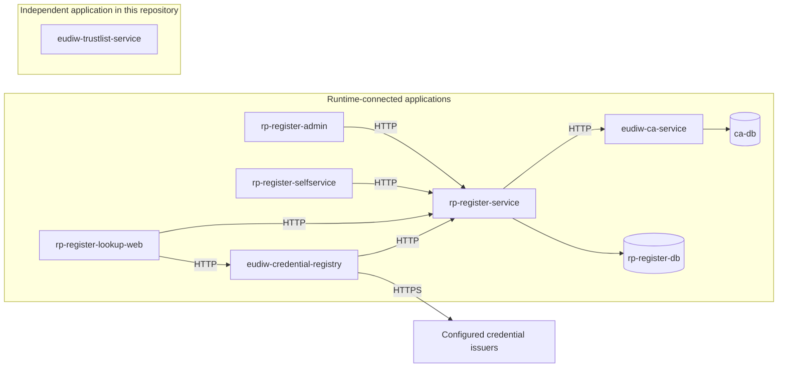

# C4 container diagram

Describe only application-level dependencies between applications, external systems, and data stores. Do not include form fields, data formats, validation rules, or implementation details.

Organisations use the register to publish which wallet data their services intend to request in [Digdir's digital wallet sandbox](https://docs.digdir.no/docs/lommebok/lommebok_om.html).

## Specification sources

Use [TS5](https://github.com/eu-digital-identity-wallet/eudi-doc-standards-and-technical-specifications/blob/main/docs/technical-specifications/ts5-common-formats-and-api-for-rp-registration-information.md) for the registration API and data format. Use [TS6](https://github.com/eu-digital-identity-wallet/eudi-doc-standards-and-technical-specifications/blob/main/docs/technical-specifications/ts6-common-set-of-rp-information-to-be-registered.md) for the information that a relying party registers.

## Containers

The diagram shows runtime connections and storage dependencies.

The RP register service owns the list of registered credential issuers. The credential registry uses this list to retrieve issuer metadata.

The connections shown here are defined in [`docker-compose.yaml`](../docker-compose.yaml) and the applications' `application*.yaml` files. Update this diagram when an application or runtime connection changes.
